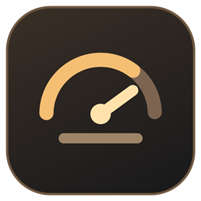
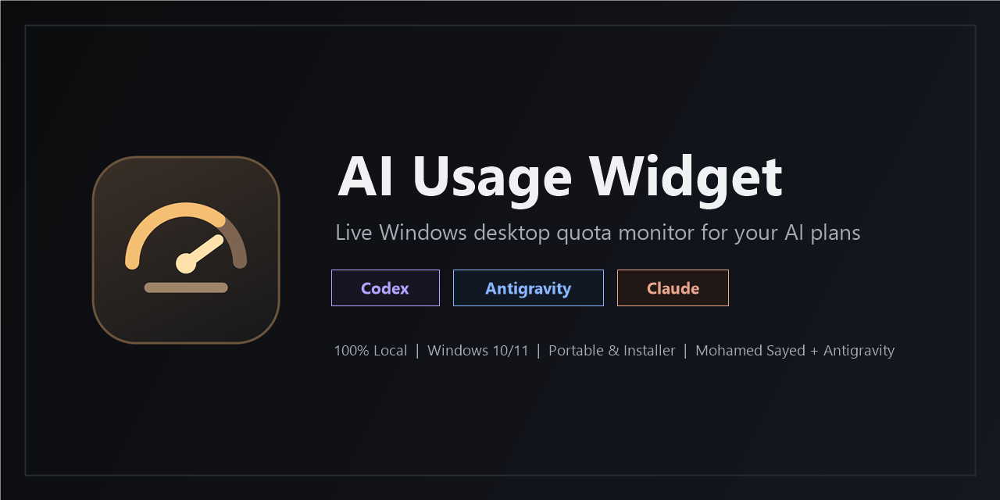

<p align="center">
  
</p>

<h1 align="center">AI Usage Widget</h1>

<p align="center">
  A lightweight, dark-mode Windows desktop widget that keeps your live AI subscription quotas visible at a glance—covering <strong>OpenAI Codex</strong>, <strong>Google Antigravity</strong>, and <strong>Anthropic Claude</strong> in one compact, always-on-top window.
</p>

<p align="center">
  
</p>

Stop getting blindsided mid-task by a 5-hour rolling cap or weekly limit. AI Usage Widget monitors all three tools locally, displays remaining quota gauges with color-coded thresholds and live reset countdowns, and stays quietly out of your way until you need it.

---

## Features

- **Unified Multi-Provider Quota Dashboard**
  - **Codex:** Reads your primary, weekly, and model-specific rate-limit buckets via the local Codex app/CLI.
  - **Antigravity:** Reads 5-hour and weekly model pool quotas directly from the local Antigravity desktop daemon.
  - **Claude:** Reads 5-hour session, weekly all-models, and model-scoped limits (e.g., Sonnet/Opus) via Claude Code `/usage` (with automatic fallback to your local `.claude.json` cache when offline).
- **Live Reset Countdowns & Visual Warnings**
  - Color-coded progress bars (accent → amber at ≤ 25% → red at ≤ 10%) with per-window countdown timers and exact local reset timestamps on hover.
- **One-Second Quota Refresh**
  - Checks each provider every second, including while the widget is in the tray. Each provider has one request in flight at a time, and failed checks retry with exponential backoff (`5s`–`60s`). Use the Refresh button or `F5` to retry immediately.
- **Unobtrusive Desktop UX**
  - Frameless dark-mode UI with drag-to-move, pin always-on-top, collapsible provider cards, resizable dimensions with **Fit height to content**, **Close to tray**, single-instance restore on relaunch, and persistent window settings.
- **Installer & Portable Editions**
  - Zero external runtime dependencies—runs natively on Windows 10/11 via built-in .NET Framework 4.8.
  - Per-user installer (no administrator / UAC elevation required) or standalone Portable `.exe`.

---

## Download & Installation

Grab the latest release from [**Releases**](https://github.com/CipherVaults/AI-Usage-Widget/releases):

| Edition | File | Best For |
| :--- | :--- | :--- |
| **Windows Installer** | `AI.Usage.Widget.Setup.v1.0.1.exe` | Standard per-user install (`%LOCALAPPDATA%\Programs\AI Usage Widget`) with Start Menu shortcut & clean uninstall/upgrade. |
| **Portable** | `AI.Usage.Widget.Portable.v1.0.1.exe` | Zero-install single executable; stores settings alongside the `.exe` in `AI Usage Widget.settings.json`. |

### Verify Download Integrity (SHA-256)

Every release includes `.sha256` checksum files. Verify in PowerShell:

```powershell
Get-FileHash ".\AI.Usage.Widget.Portable.v1.0.1.exe" -Algorithm SHA256
Get-Content ".\AI.Usage.Widget.Portable.v1.0.1.exe.sha256"
```

---

## Requirements

- **OS:** Windows 10 or Windows 11 (x64 / x86) with built-in .NET Framework 4.8.
- **Providers (install any combination you use):**
  - **Codex:** OpenAI Codex desktop app or CLI signed in with ChatGPT.
  - **Antigravity:** Google Antigravity desktop app running and signed in.
  - **Claude:** Claude Code for Windows signed in (`/login`).

Providers you don't use can simply be collapsed by clicking their header bar.

---

## How It Works (100% Local & Privacy-First)

AI Usage Widget **never** asks for your API keys, passwords, or OAuth tokens, and makes **no** telemetry or third-party network calls:

1. **Codex:** Spawns your locally installed `codex.exe app-server --listen stdio://` in an isolated empty working directory and queries `account/rateLimits/read` over local stdin/stdout JSON-RPC.
2. **Antigravity:** Reads the local daemon descriptor under `%USERPROFILE%\.gemini\antigravity\daemon\hub_*.json`, verifies the owning loopback listener PID (`127.0.0.1`) via `GetExtendedTcpTable` and process validation, and sends a local loopback POST (`AllowAutoRedirect = false`, `Proxy = null`) to `RetrieveUserQuotaSummary`.
3. **Claude:** Runs your locally installed Claude Code CLI with `--safe-mode --strict-mcp-config --no-session-persistence --print` in an isolated empty working directory, verifies the CLI advertises the built-in `usage` command before submitting `/usage`, and enforces `num_turns == 0` so **zero LLM tokens or messages are consumed**. Falls back to cached utilization in `.claude.json` if the CLI is busy or unavailable.

---

## Security Hardening

This project is hardened against common Windows desktop & portable-app threats:

- **DLL Search-Order Protection:** Assembly-level `[DefaultDllImportSearchPaths(DllImportSearchPath.System32)]`, explicit `System32` binding on all P/Invoke declarations (`iphlpapi.dll`, `wintrust.dll`, `kernel32.dll`, `shell32.dll`), and `SetDllDirectory("")` at startup to prevent DLL planting (e.g., when running Portable mode from `Downloads`).
- **Compiler & Runtime Mitigations:** Built with `.NET Framework 4.8` `TargetFrameworkAttribute` (avoiding legacy 4.0 quirks mode), `/highentropyva+` (64-bit high-entropy ASLR), `/checked+` (overflow checking), `/warnaserror+`, `DynamicBase`, `NXCompat`, and `NoSEH`.
- **Least Privilege:** Runs strictly as `asInvoker` (`uiAccess="false"`), with a per-user Inno Setup installer (`PrivilegesRequired=lowest`, `AllowUNCPath=no`, `AppMutex`, local non-reparse path validation on upgrade).
- **Bounded I/O & Safe Persistence:** Strict byte/character caps on all file, HTTP, and child stdout reads; regex execution timeouts; atomic temp-file + replace settings persistence; reparse-point checks; and sanitized error messages that never expose vendor account details.

---

## Building from Source

Requires Windows 10/11 (built-in .NET Framework 4.x `csc.exe`) and [Inno Setup 6](https://jrsoftware.org/isinfo.php) (only needed for `-Installer`).

```powershell
# Build Portable executable
powershell -NoProfile -ExecutionPolicy Bypass -File .\Build.ps1 -Portable

# Build Windows Installer
powershell -NoProfile -ExecutionPolicy Bypass -File .\Build.ps1 -Installer

# Build both Portable and Installer + SHA-256 checksums
powershell -NoProfile -ExecutionPolicy Bypass -File .\Build.ps1 -Portable -Installer
```

Outputs are written to `release\` along with `.sha256` checksum files.

---

## Project Structure

```text
├── app/
│   ├── AIUsageWidget.cs      # WPF desktop window, tray integration, single-instance & settings
│   ├── AIUsageWidget.xaml    # Frameless dark-mode layout & styles
│   ├── AIUsageWidget.ico     # Application icon
│   ├── app.manifest          # Version identity, asInvoker privileges, DPI awareness
│   ├── QuotaSources.cs       # Codex JSON-RPC, Antigravity loopback IPC, security helpers
│   ├── ClaudeQuota.cs        # Claude Code /usage stream-json reader & cache parser
│   └── QuotaUpdates.cs       # Provider polling and retry backoff
├── installer/
│   └── AIUsageWidget.iss     # Inno Setup 6 per-user installer & safe upgrade script
├── Build.ps1                 # Build script with hardening flags & SHA-256 generation
├── LICENSE                   # MIT License
└── README.md
```

---

## Credits

Created by **Mohamed Sayed + Antigravity**.

---

## License

Released under the [MIT License](LICENSE).
